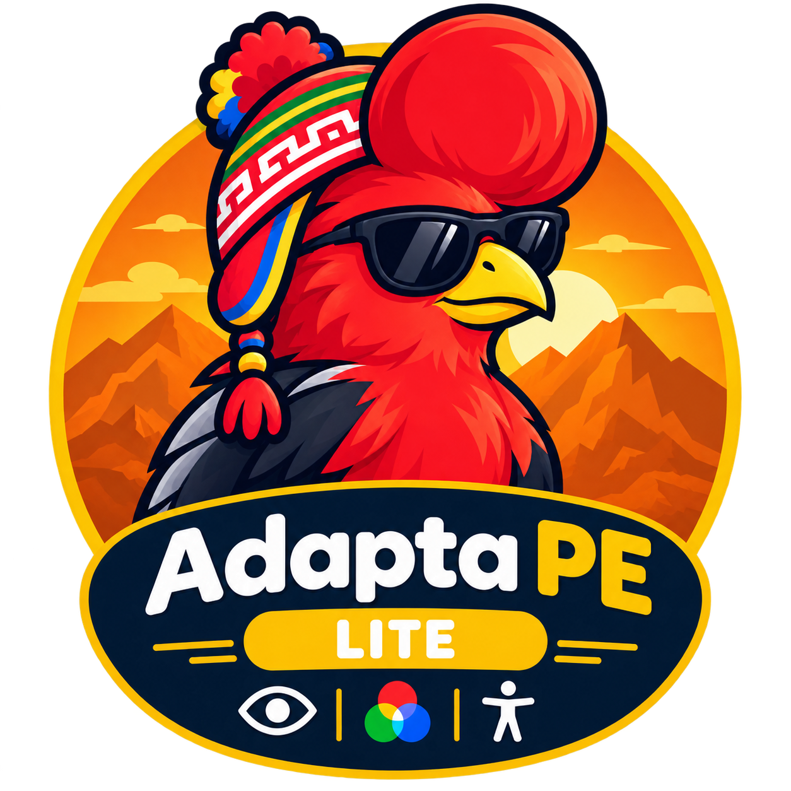

<p align="center"></p>

# Adapta PE Lite para macOS

## Comandos naturales: bloque del 17 de octubre de 2026

La palabra predeterminada admite «Computadora», «Computadoras» y «Computador». Una llamada seguida sólo de cortesía mantiene la espera de ocho segundos. Las palabras personales siguen siendo independientes: elegir «Asistente» no activa esos alias. Se conserva el texto original tras la llamada, incluidos espacios interiores y Unicode; las pruebas de texto no acreditan reconocimiento con micrófono.

El parser acepta cortesía y variantes españolas como «por favor abre Safari», «quiero que abras Safari», «ábrame Safari» y «abrí Safari». Conserva mayúsculas, acentos y espacios interiores del dictado. La selección literal y las consultas a la API conservan su puntuación. Se mantienen los atajos nativos existentes.

Las partículas finales ambiguas «pe», «pues», «ya pe» y «ya pues» sólo se retiran si llevan una coma antes. Así «busca Adapta PE» y «busca qué significa pues» conservan su contenido. «Abre Safari, pe» se prepara como «abre Safari». Es una diferencia conservadora respecto a la extensión de referencia; no se adivina si una palabra final pertenece a un nombre o consulta.

Este bloque porta reglas de texto españolas. No añade reconocimiento acústico en seis idiomas ni acredita precisión con micrófonos reales.

Lite conserva voz, lectura manual, filtros y mascotas. No se incorporan cámara, cinética, TalkBack automático ni IA en este bloque.

**Voz y filtros de pantalla en una aplicación independiente para macOS.** Adapta PE Lite permite controlar aplicaciones, dictar, navegar y leer contenido accesible mediante órdenes en español. Incluye siete simulaciones de daltonismo, barra de menú y panel flotante. Conserva la identidad visual de Adapta PE con su logo Lite.

Este repositorio contiene una app completa con sus propias fuentes, assets, proyecto Xcode y pruebas. No necesita el código ni la instalación de Base. No incluye cámara, cursor cinético, TalkBack automático ni IA externa. La lectura solicitada por voz sí pertenece al asistente Lite.

[Instalación](#instalación-desde-terminal) · [Uso](#primer-inicio-y-uso) · [Comandos](#comandos-de-voz) · [Código](#documentación-del-código) · [Pruebas](#compilación-y-pruebas) · [Guía detallada](docs/LITE.md)

## Mascotas y mejoras compartidas · 11 de octubre de 2026

Se contrastaron las extensiones completas 13.0 y Lite 3.0, sus README y los motores actuales. Las mejoras se adaptan a las APIs del escritorio; cada edición conserva sus funciones.

En **Mascota**, elige **Tinku** (gallito), **Cuchu** (cuy), **Yati** (llama) o **Sin mascota**, que es el valor inicial. Sólo se decodifica el atlas elegido. Los cuadros nativos de 96×112 conservan transparencia, secuencias de entrada/salida y duración de los sprites originales. Un temporizador sigue la duración de los cuadros; otro se programa una sola vez para el descanso. No se repinta toda la interfaz. La animación se detiene al dormir, con movimiento reducido y durante suspensión. Ocultar/cambiar libera el atlas anterior.

La mascota mira hacia el cursor cercano, acompaña la llamada al asistente y cambia entre hablar y leer durante la salida de voz real. **Saludar**, **Dormir** y **Despertar** permiten controlar su estado; dormir se mantiene hasta despertar. El dibujo deja pasar los clics. Arrastra su nombre entre pantallas o pulsa **Mover con teclas**, usa las flechas y vuelve con **Escape**. **Otro monitor** cambia la pantalla sin arrastrar; se recuerdan mascota, monitor y posición relativa.

### Interfaz, panel y compañía

Las funciones principales quedan en secciones con nombres directos. **Usar panel** abre PiP; **Opciones** permite elegir mascota, filtros, esquina y monitor. Los dispositivos y preferencias de reconocimiento permanecen bajo sus opciones avanzadas. Lite mantiene voz, filtros y lectura manual por orden; no añade cámara, cursor, TalkBack automático ni IA. **Detener todo** permanece accesible.

Activa **Mover mascota y panel juntos** para situar la mascota arriba de PiP. Arrastra el título del panel o el nombre de la mascota para mover ambos. Al separarlos, la mascota recupera su posición propia. Se recuerdan unión, monitor y posición relativa del panel; cambiar de esquina vuelve al anclaje. El tamaño se limita al área útil reservando lugar para la mascota. En macOS también puedes enfocar el título y usar las flechas. PiP conserva fondo sólido para leer incluso cuando está inactivo. El control Ajustes usa Liquid Glass desde macOS 26; versiones anteriores y transparencia reducida usan el estilo nativo sencillo.

La llamada por voz usa el teléfono una vez; ejecutar una orden usa la laptop una vez. Leer y hablar acompañan únicamente la salida de voz real. Después vuelve a reposo, sin dejar teléfono/laptop trabajando indefinidamente. Tras **90 segundos sin interacción**, descansa y detiene su animación. La próxima acción despierta el descanso automático; **Dormir** manual exige **Despertar**. No duerme automáticamente durante una lectura o respuesta hablada.

Di **«computadora, une mascota al panel»**, **«separa mascota del panel»** o **«panel esquina superior izquierda»**. También se admite **«mueve el panel a la esquina inferior derecha»**. Cambiar posición usa los mismos límites que el arrastre y conserva el control disponible.

Después de llamar al asistente, admite **«mascota Cu Chu»**, **«mascota Tinku»**, **«mascota Yaty»**, **«elige mascota tiiinku»**, **«oculta mascota»**, **«saluda mascota»**, **«duerme mascota»** y **«despierta mascota»**. Las órdenes se reconocen completas; mencionar una mascota dentro de dictado o búsqueda conserva ese texto.

**Lite continúa independiente:** voz, lectura manual solicitada, siete filtros y mascota. No se añaden cámara, cursor cinético, TalkBack automático ni IA.

### Pantalla completa y varios monitores

Los filtros usan una captura/composición local por pantalla. Se reconstruyen al conectar o retirar monitores y al cambiar su disposición. Las capas y mascotas se unen a Spaces y a otras apps en pantalla completa mediante [canJoinAllApplications](https://developer.apple.com/documentation/appkit/nswindow/collectionbehavior-swift.struct/canjoinallapplications); el filtro queda debajo de los controles propios de Adapta PE, evita capturarse a sí mismo y deja pasar los clics. **Preparando**, **Activo** y los errores explican el estado real.

La captura requiere el permiso de Grabación de pantalla. Contenido protegido, escritorio seguro o juegos que usen presentación exclusiva pueden impedir captura/capas; usa pantalla completa de escritorio cuando la app lo permita. La lectura requiere controles AX publicados y la entrada puede ser rechazada por cada juego. No se promete acceso a superficies que el sistema protege. La composición por monitor tiene coste de GPU/memoria; 30 FPS es el límite solicitado, no una medición garantizada.

### Código y comprobación

- [`Mascot.swift`](Adapta-PE-Lite/Mascot.swift): atlas/secuencias, comandos, ventanas, voz y controles SwiftUI.
- [`Mascotas/`](Adapta-PE-Lite/Mascotas/): sprites y manifiestos locales.

Compilación Debug y 3 pruebas de lógica aprobadas con Xcode 27, sin activar sensores. Se comprobaron selección y controles de mascotas en la interfaz real. Micrófono, filtros activos, juegos exclusivos, monitor externo y consumo/FPS en equipo real requieren validación física. No se regeneró una distribución firmada/notarizada.

## Funciones

| Función | Comportamiento actual |
| --- | --- |
| Asistente de voz | Palabra personalizable, señal de escucha, ventana de ocho segundos, dictado Unicode y respuestas habladas. |
| Aplicaciones y navegador | Abrir, enfocar o cerrar apps, abrir sitios, buscar, manejar pestañas y ejecutar atajos conocidos. |
| Accesibilidad | Enumerar menús/campos, enfocar, seleccionar, escribir, activar controles y leer bajo una orden explícita. |
| Filtros | Protanomalía, protanopía, deuteranomalía, deuteranopía, tritanomalía, tritanopía y acromatopsia. |
| Mascota opcional | Tinku, Cuchu o Yati; voz, estados, movimiento entre pantallas y teclado. |
| Segundo plano | Cerrar ajustes mantiene la asistencia; barra de menú y panel flotante permiten controlarla. |
| Preferencias | Micrófono, palabra de activación, opción de reconocimiento Apple por red, filtro, monitor/esquina del panel e inicio de sesión voluntario. |

Las matrices son simulaciones visuales; no constituyen una corrección médica. Las acciones dependen de los controles accesibles que publique cada app. La lectura manual no sustituye a VoiceOver.

## Requisitos

- macOS **14 o posterior**, según `MACOSX_DEPLOYMENT_TARGET` del proyecto.
- Xcode compatible con el formato del proyecto y grupos sincronizados. Esta revisión se compiló con **Xcode 27**.
- Git para clonar; micrófono para voz y los permisos de cada módulo.
- Un reconocedor español de Apple disponible localmente. La app comprueba `es-PE`, `es-ES` y `es-MX`; no presupone que cada equipo tenga todos los modelos.

No utiliza Python, Flask, paquetes de terceros ni dependencias de Base. El código usa SwiftUI, AppKit, AVFoundation, Speech, Accessibility, CoreGraphics, ScreenCaptureKit y ServiceManagement. Los permisos y disponibilidad de reconocimiento se comprueban al activar cada función.

El proyecto conserva el equipo de firma del autor. Si vas a firmar, selecciona tu propio equipo en **Signing & Capabilities**. El deployment target y una compilación correcta no acreditan pruebas físicas en todas las versiones de macOS ni en ambas arquitecturas.

## Instalación desde terminal

Instala Xcode, ábrelo para completar sus componentes y selecciona sus herramientas si todavía no están activas:

```sh
sudo xcode-select --switch /Applications/Xcode.app/Contents/Developer
xcodebuild -version
```

Clona esta app:

```sh
git clone https://github.com/TheAlejo160/Adapta-PE-Lite-MacOS.git
cd Adapta-PE-Lite-MacOS
open Adapta-PE-Lite.xcodeproj
```

En Xcode, selecciona el esquema **Adapta-PE-Lite**, destino **My Mac** y tu firma de desarrollo. Para compilar y abrir desde terminal:

```sh
./script/build_and_run.sh --verify
```

El script detiene la instancia anterior de Lite y compila Debug en una carpeta temporal. `--verify` comprueba que el proceso arranca; no prueba micrófono ni filtros. Sin argumentos compila y abre; `--debug` abre Xcode; `--logs` y `--telemetry` muestran registros locales.

Para una instalación local persistente, sal de Lite desde la barra de menú, compila Release con tu firma configurada y copia el bundle:

```sh
xcodebuild -project Adapta-PE-Lite.xcodeproj -scheme Adapta-PE-Lite \
  -configuration Release -derivedDataPath build/lite build
mkdir -p "$HOME/Applications"
ditto build/lite/Build/Products/Release/Adapta-PE-Lite.app \
  "$HOME/Applications/Adapta-PE-Lite.app"
open "$HOME/Applications/Adapta-PE-Lite.app"
```

Para actualizar, ejecuta `git pull --ff-only` con tu copia limpia, cierra Lite y repite compilación/copia. La instalación local no acredita firma y notarización para distribuir a otros equipos. Este repositorio publica fuentes; no promete un DMG ni una release binaria.

Para desinstalar, desactiva **Iniciar con macOS**, pulsa **Salir de Adapta PE Lite** y retira el bundle de `~/Applications`. Los permisos y preferencias del usuario no se eliminan al borrar la app.

## Primer inicio y uso

1. El primer inicio mantiene voz y filtro apagados. Abre la sección **Voz**, elige micrófono y activa el asistente.
2. Autoriza micrófono y reconocimiento de voz. Concede **Accesibilidad** para operar otras apps desde **Ajustes del Sistema > Privacidad y seguridad**.
3. Di **«Computadora»**, espera la señal y pronuncia una orden antes de ocho segundos; también puedes decir palabra y orden en una misma frase.
4. Usa **Daltonismo** para seleccionar un filtro. La captura de pantalla se solicita al activarlo. **Sin filtro** detiene la composición.
5. Cierra ajustes para continuar en segundo plano. La barra de menú abre ajustes, cambia filtros, activa/apaga voz, muestra el panel o detiene todo.

El panel muestra estado, transcripción temporal, respuesta y elecciones sin convertirse en el destino de la orden. Puedes anclarlo a una esquina y monitor. Las coincidencias ambiguas ofrecen opciones numeradas; **«cancelar»** retira la selección pendiente.

**Detener todo** cancela acciones, escucha y TTS, retira filtros y recuerda que los módulos están apagados. **Salir** libera recursos y conserva las preferencias para el siguiente inicio. El reposo suspende los módulos y el retorno revalida capacidades; restaurar una sesión no abre permisos nuevos.

Si usas Base al mismo tiempo, activa voz y filtros en una sola edición para evitar que ambas operen sobre el mismo escritorio.

## Comandos de voz

Los ejemplos se pronuncian después de «Computadora». No son lenguaje libre ilimitado: `CommandParser.swift` contiene las intenciones y sinónimos admitidos.

| Objetivo | Ejemplos |
| --- | --- |
| Apps y sitios | «abre Safari», «abre Google», «cierra Safari». |
| Buscar | «busca accesibilidad en Wikipedia», «busca recetas en nueva pestaña». |
| Dictar | «escribe Hola, ¿cómo estás?», «escribe Ana en el campo Nombre». |
| Controles | «muestra campos», «enfoca Buscar», «selecciona Aceptar», «dale clic». |
| Menús | «muestra acciones», «ejecuta la acción Guardar». |
| Teclado | «guardar», «copiar», «pegar», «atajo comando shift s». |
| Navegación | «nueva pestaña», «cierra pestaña», «atrás», «recarga», «baja», «aumenta zoom». |
| Lectura manual | «lee la pantalla», «lee Guardar», «silencio». |
| Elecciones | «elige dos», «cancelar». |
| Interfaz | «mostrar ajustes», «modo flotante», «detener todo». |

La normalización de intenciones no borra Unicode, signos ni mayúsculas del dictado. Las URLs y consultas se construyen desde el catálogo. Una orden no se ejecuta como shell. Los controles protegidos se excluyen de lectura y escritura. Si una app no expone un campo o menú por Accesibilidad, el asistente informa la limitación; puede usarse un atajo conocido cuando proceda.

## Permisos y privacidad

| Permiso | Uso |
| --- | --- |
| Micrófono | Captura de audio mientras el asistente está activo. |
| Reconocimiento de voz | Speech transforma audio en texto; se prefiere reconocimiento local. |
| Accesibilidad | Lectura manual y acciones sobre apps externas. |
| Grabación de pantalla | Captura/composición local necesaria para filtros; se solicita al activarlos. |
| Automatización | Control del navegador cuando la acción requiere Apple Events. |

Lite no solicita cámara. **Apple por red** sólo se admite mediante una opción explícita: si la activas, Apple puede procesar el audio para reconocimiento. La ausencia de un modelo local produce diagnóstico; no equivale a tener voz disponible en todos los Mac.

No se guardan grabaciones, capturas ni transcripciones. El texto mostrado y la selección viven en memoria. Los filtros procesan imágenes localmente. Preferencias y permisos están separados de Base por `com.thealejo.Adapta-PE-Lite`; el repositorio no contiene datos personales de sesión ni llaves de firma.

## Documentación del código

| Archivo | Responsabilidad |
| --- | --- |
| [Adapta_PE_LiteApp.swift](Adapta-PE-Lite/Adapta_PE_LiteApp.swift) | Entrada, composición `AppModel`, barra de menú, preferencias, panel, inicio de sesión, suspensión y parada. |
| [ContentView.swift](Adapta-PE-Lite/ContentView.swift) | Secciones de voz/filtros y controles nativos SwiftUI. |
| [FloatingView.swift](Adapta-PE-Lite/FloatingView.swift) | Estado temporal, respuestas, elecciones y controles del panel flotante. |
| [VoiceManager.swift](Adapta-PE-Lite/VoiceManager.swift) | Captura AVFoundation, Speech, disponibilidad local, recuperación y coordinación con TTS. |
| [VoiceInputState.swift](Adapta-PE-Lite/VoiceInputState.swift) | Palabra de activación, ventana de ocho segundos, deduplicación e interrupción de lectura. |
| [CommandParser.swift](Adapta-PE-Lite/CommandParser.swift) | Intenciones, sinónimos, sitios, atajos, destinos y elecciones. |
| [ActionManager.swift](Adapta-PE-Lite/ActionManager.swift) | Ejecuta órdenes, mantiene destino externo y coordina respuestas y opciones. |
| [ApplicationCatalog.swift](Adapta-PE-Lite/ApplicationCatalog.swift) | Catálogo local de apps y resolución de nombres/alias. |
| [DesktopAccess.swift](Adapta-PE-Lite/DesktopAccess.swift) | Árbol AX, campos, menús, selección, lectura manual y entrada CGEvent. |
| [ColorFilterManager.swift](Adapta-PE-Lite/ColorFilterManager.swift) | Siete matrices, captura/composición de pantallas y liberación del filtro. |
| [script/build_and_run.sh](script/build_and_run.sh) | Compilación/lanzamiento y modos de diagnóstico local. |
| [LiteTests.swift](Adapta-PE-LiteTests/LiteTests.swift) y [LiteUITests.swift](Adapta-PE-LiteUITests/LiteUITests.swift) | Regresiones de alcance y sesión; navegación de interfaz sin sensores. |

El recorrido de voz es **AVFoundation → Speech → VoiceInputState → CommandParser → ActionManager → AX/CGEvent/Apple Events → respuesta**. `AppModel` conecta los módulos y coordina su vida. `stopAll` invalida acciones pendientes antes de detener voz, filtros, TTS y selección. La UI mantiene separado el destino externo de sus propias ventanas.

El recorrido de filtros es **captura local de pantalla → matriz de color → composición → salida visible**. Retirar el filtro invalida la salida y libera captura/ventanas. No actúa sobre los colores del archivo original.

Los motores excluidos no forman parte de las fuentes compiladas: no hay TrackingManager, KineticState, OptionalAI ni TalkBackManager. Lite no cambia de edición mediante una condición `LITE` ni referencia archivos de Base. El proyecto y el esquema compartido se conservan; `xcuserdata`, DerivedData, `.app`, `.dmg`, builds, logs y credenciales quedan fuera de Git.

## Compilación y pruebas

Las pruebas de lógica pueden ejecutarse sin firma de distribución:

```sh
xcodebuild -project Adapta-PE-Lite.xcodeproj -scheme Adapta-PE-Lite \
  -destination 'platform=macOS' -derivedDataPath /tmp/adapta-lite-check \
  -only-testing:Adapta-PE-LiteTests CODE_SIGNING_ALLOWED=NO test
```

Para incluir las pruebas de interfaz, usa una firma de desarrollo configurada y ejecuta `test` sin restringir el target:

```sh
xcodebuild -project Adapta-PE-Lite.xcodeproj -scheme Adapta-PE-Lite \
  -destination 'platform=macOS' -derivedDataPath /tmp/adapta-lite-ui test
```

La regresión de lógica valida alcance Lite, Unicode, matrices, apagado/memoria de sesión, inicio de sesión y anclaje del panel. La prueba UI recorre ambas secciones, el panel y el cierre de ajustes sin activar sensores. Consulta [docs/LITE.md](docs/LITE.md) para las capturas y resultados de interfaz.

El **3 de octubre de 2026** pasó la prueba de lógica desde este proyecto independiente con Xcode 27. Se contrastó el mapa con el índice actualizado y sus fuentes; la configuración Xcode y el script se leyeron directamente. Esto no acredita reconocimiento español con micrófono real, permisos, filtros en múltiples pantallas ni firma/notarización de distribución. Esos escenarios requieren pruebas físicas.

## Solución de problemas

| Síntoma | Comprobación |
| --- | --- |
| Error de equipo de firma | Cambia el equipo del autor por el tuyo en Xcode. |
| `xcodebuild` apunta sólo a Command Line Tools | Selecciona el Xcode completo con `xcode-select` y completa sus componentes. |
| No hay reconocimiento local | Comprueba disponibilidad de Speech español y micrófono; Apple por red es una decisión explícita del usuario. |
| No actúa sobre otra app | Comprueba Accesibilidad y que el control exponga un patrón AX; algunos contenidos no son accesibles. |
| No se ve el filtro | Comprueba permiso de captura de pantalla, filtro seleccionado y diagnóstico del módulo. |
| Cerrar ajustes no termina Lite | Es el funcionamiento en segundo plano; usa **Salir** desde la barra de menú. |

## Proyectos de la familia Adapta PE

| Programa | Repositorio |
| --- | --- |
| Extensión Base | [Adapta-PE](https://github.com/TheAlejo160/Adapta-PE) |
| Extensión Lite | [Adapta-PE-Lite](https://github.com/TheAlejo160/Adapta-PE-Lite) |
| Windows Base | [Adapta-PE-Win](https://github.com/TheAlejo160/Adapta-PE-Win) |
| Windows Lite | [Adapta-PE-Lite-Win](https://github.com/TheAlejo160/Adapta-PE-Lite-Win) |
| macOS completo | [Adapta-PE-MacOS-Intel-Apple-Silicon-](https://github.com/TheAlejo160/Adapta-PE-MacOS-Intel-Apple-Silicon-) |
| macOS Lite | [Adapta-PE-Lite-MacOS](https://github.com/TheAlejo160/Adapta-PE-Lite-MacOS) |

Cada plataforma tiene su propio proyecto, permisos y versión. Un ZIP de extensión no instala una app de escritorio.

## Licencia

© 2026 Rodrigo Alejandro Apcho Aliaga — TheAlejo160. [LICENSE](LICENSE): **CC BY-NC-SA 4.0**. Se mantienen las atribuciones y condiciones del autor; publicar las fuentes no cambia sus condiciones de reutilización.

## Filtros: presentación segura (17 de octubre de 2026)

El filtro espera una imagen procesada antes de mostrar su ventana, evitando una cubierta negra al arrancar. Detener invalida inmediatamente la presentación: un cuadro que ya estaba en camino no vuelve a mostrarla. El estado informa de filtro activo al recibir el primer cuadro. Se mantienen las matrices, el permiso de Grabación de pantalla y el procesamiento local en memoria.

FilterPresentationTests.testFirstImageAndCancellation usa una imagen sintética para probar la primera presentación, un solo aviso inicial y el rechazo después de invalidar. Esta prueba no acredita captura real, contenido protegido, monitores ni rendimiento físico.

### Llamada personal y parada durante lectura: 17 de octubre de 2026

La activación de voz ahora compara acentos y espacios equivalentes sin perder los índices del texto original. Una llamada personalizada como «Máquina Azul» admite transcripción sin tilde y espacios variables; el contenido que sigue conserva acentos, mayúsculas y espacios. Durante TTS, «por favor detén todo» atraviesa la protección de eco y llega a la parada global; dictado y búsquedas conservan su contenido. PersonalWakeTests y GlobalStopTests pasaron con Xcode en macOS Apple Silicon. Son pruebas textuales, no validación del micrófono ni del reconocimiento acústico.

### Contraste, foco y micrófono: 17 de octubre de 2026

El fondo de cabecera usa una capa negra del 60 % para que el subtítulo blanco mantenga contraste incluso sobre zonas claras (peor caso calculado 5,74:1). Los botones propios añaden un indicador interior de foco por teclado. El selector conserva Predeterminado y la selección válida; actualizar un ID retirado vuelve a Predeterminado. Una captura solicitada con un micrófono explícito ausente falla en lugar de usar silenciosamente otro dispositivo. Las pruebas de selección con IDs sintéticos y la compilación pasaron; no se validaron desconexión física, dibujo del foco ni VoiceOver.
